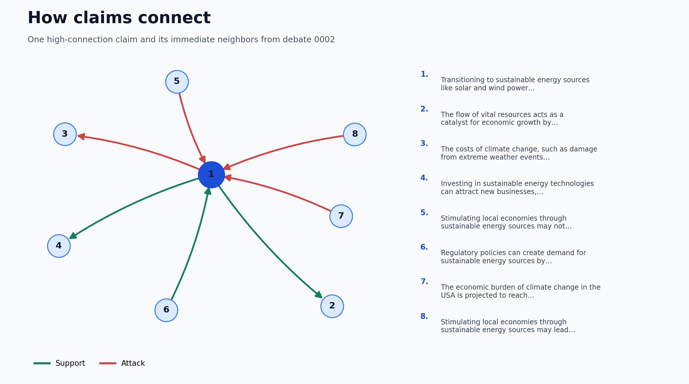

# Debate stance and argument graphs

This project turns debate claims into a directed argument graph. It labels claim pairs as **support**, **attack**, or **neutral**, then measures influence, clusters, and vulnerable connections. The active pipeline combines NLI and stance predictions with optional graph features. Interactive graph views and tabular analysis make the results inspectable.

## See the result

The included example is debate `node_link_data-debate-eval-0002`. Its combined view contains **653 nodes and 618 support/attack edges**. The preview shows one claim and its neighbors; the HTML views show the larger graph. These files were generated from saved graph TSVs with the analysis-only command shown below; this verification did not retrain a model.



**[Open the interactive graph gallery](https://shanik-stack.github.io/Graph-Discourse-Analysis-v2/)**.

| View | What it shows |
| --- | --- |
| [Combined graph](https://shanik-stack.github.io/Graph-Discourse-Analysis-v2/examples/debate-0002/combined.html) | Support and attack edges together |
| [Support graph](https://shanik-stack.github.io/Graph-Discourse-Analysis-v2/examples/debate-0002/support.html) | Supporting relationships |
| [Attack graph](https://shanik-stack.github.io/Graph-Discourse-Analysis-v2/examples/debate-0002/attack.html) | Attacking relationships |
| [Filtered graph](https://shanik-stack.github.io/Graph-Discourse-Analysis-v2/examples/debate-0002/generic.html) | Score-filtered graph with layout controls |
| [Support in-degree](https://shanik-stack.github.io/Graph-Discourse-Analysis-v2/examples/debate-0002/support-indegree.html) | Locally supported claims |
| [Cluster themes](https://shanik-stack.github.io/Graph-Discourse-Analysis-v2/examples/debate-0002/clusters.html) | Communities of related claims |
| [Support PageRank](https://shanik-stack.github.io/Graph-Discourse-Analysis-v2/examples/debate-0002/pagerank-support.html) | Influence through support edges |
| [Attack PageRank](https://shanik-stack.github.io/Graph-Discourse-Analysis-v2/examples/debate-0002/pagerank-attack.html) | Influence through attack edges |
| [Net PageRank](https://shanik-stack.github.io/Graph-Discourse-Analysis-v2/examples/debate-0002/pagerank-net.html) | Support influence minus attack influence |
| [Minimum cuts](https://shanik-stack.github.io/Graph-Discourse-Analysis-v2/examples/debate-0002/mincut.html) | Vulnerable connections within clusters |

GitHub displays the PNG preview directly. GitHub Pages serves these links as interactive web pages. GitHub's source viewer does not execute HTML. The example HTML embeds its graph scripts so it does not need a local `lib/` directory.

## How it works

```text
Syncialo debate JSON
  -> claim pairs
  -> NLI + stance features
  -> meta or graph-aware classifier
  -> nodes.tsv + edges.tsv
  -> graph metrics + interactive HTML/PNG
```

The default export model is a logistic-regression meta classifier. The graph-aware option adds graph structure features. Separate benchmark modes compare these with context-aware and ablation variants. See [benchmark details](docs/pipeline.md).

## Run it

Requires Python 3.11 or newer. From the repository root:

```bash
python -m venv .venv
# Activate the environment for your shell, then:
python -m pip install -e .
python -m pip install -r requirements.txt
```

The quickest reproducible path uses the included graph TSVs and does not download or load neural models:

```bash
python run_pipeline.py --analysis-only --debates node_link_data-debate-eval-0002
```

This reads `outputs/pipeline/graphs/nodes.tsv` and `edges.tsv`, regenerates graph metrics under `outputs/pipeline/analysis/`, and writes visualizations under `viz_basic/`, `viz_algo/`, and `viz_generic/`. The generated results are local artifacts; the curated files above are the GitHub examples. See [outputs](outputs/README.md) for the complete output map.

For a fresh model export, run:

```bash
python run_pipeline.py --model meta --small
python run_pipeline.py --model graph-aware --small
```

Fresh export downloads or uses the Syncialo snapshot and Hugging Face model weights, so it needs network access, disk space, and a working PyTorch installation. `--small` limits the number of debates, pairs, edges, and examples; it is a smoke run, not a benchmark result. Use [benchmark_models.py](benchmark_models.py) for held-out model comparisons.

## Project map

| Path | Purpose |
| --- | --- |
| [`run_pipeline.py`](run_pipeline.py) | Main command-line entry point |
| [`benchmark_models.py`](benchmark_models.py) | Model comparison and ablation runner |
| [`src/debate_graph/pipeline/`](src/debate_graph/pipeline/) | Pipeline orchestration |
| [`src/debate_graph/stance/`](src/debate_graph/stance/) | Pair features, prediction, graph analysis, and visualization |
| [`src/debate_graph/discourse/`](src/debate_graph/discourse/) | Earlier discourse-graph experiments |
| [`docs/`](docs/) | Pipeline guide, walkthrough, and debate index |
| [`research/`](research/) | Reports and presentation sources |
| [`data/`](data/) | Input datasets |
| [`examples/debate-0002/`](examples/debate-0002/) | Curated, portable output sample |
| [`legacy/`](legacy/) | Historical experiments retained after a [feature audit](legacy/README.md) |

For the detailed processing order, see the [pipeline walkthrough](docs/walkthrough.md). The `legacy/` tree remains because its notebooks and some experiment paths have no verified equivalent in the active workflow.

## Verification scope

The analysis-only run completed on the saved debate graph and regenerated the example visualizations. Fresh model inference and benchmark training were **not** verified in this environment because PyTorch failed to initialize a Windows DLL. The saved graph is therefore an example of existing model output, not a newly trained result from this cleanup.
